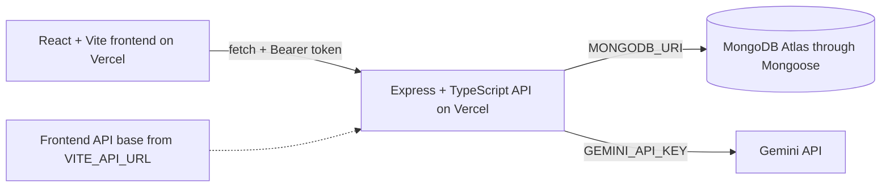

# Campus Lost & Found Tracker API

This repository contains the Express and TypeScript API for the Campus Lost & Found Tracker. It persists users, item reports, and claims in MongoDB through Mongoose, protects signed-in operations with JWT authentication, validates AI review requests with Zod, and provides a rate-limited Gemini review endpoint for lost and found item reports.

## Features

- MongoDB and Mongoose persistence for users, items, and claims.
- JWT authentication for protected operations.
- Separate five-attempt-per-15-minute limits for public login and registration endpoints.
- Item browsing and owner-managed item routes.
- Authenticated claim routes.
- Zod validation for AI item-report descriptions.
- Protected Gemini-powered report review with a limit of five requests per user per minute.
- Health endpoint that reports API and database readiness.

## API routes

| Method | Path | Access | Purpose |
| --- | --- | --- | --- |
| GET | /api/health | Public | API and database readiness |
| POST | /api/auth/register | Public, rate limited | Register a student account |
| POST | /api/auth/login | Public, rate limited | Sign in and receive a JWT |
| GET | /api/items | Public | Browse item reports |
| GET | /api/items/:id | Public | Read an item report |
| POST | /api/items | JWT | Create an item report |
| PATCH | /api/items/:id | JWT | Update an owned item report |
| DELETE | /api/items/:id | JWT | Archive an owned item report while preserving its history |
| GET | /api/claims | JWT | List the signed-in user's claims |
| GET | /api/claims/received | JWT | List claims on the signed-in user's items without private proof |
| GET | /api/claims/review | Security or admin role | List pending claims with proof for staff review |
| POST | /api/claims | JWT | Submit an eligible claim for a found item |
| PATCH | /api/claims/:id/status | Security or admin role | Approve or reject a pending claim |
| POST | /api/ai | JWT and rate limited | Review a lost or found item report |

Protected routes expect an Authorization header in the form Bearer followed by a valid JWT.
Authenticated requests reload the user's account and role from MongoDB so deactivated accounts and client-supplied role claims are not trusted. Each claimant may create at most one Claim for an Item; a rejected Claim remains in history and does not allow another submission. Claim checks and Item archival coordinate through a transaction and the Item's internal claim revision. Archival returns HTTP 409 while an Item has a pending or approved Claim, preserves rejected Claim history, and is idempotent for an already archived Item. Archived Items are hidden from public item lists while authorized staff review can still see pending Claims with archived Item context and may reject them.

Login and registration each allow five attempts per 15-minute window, keyed by the IP address Express observes. The app does not enable Express `trust proxy`, so client-supplied forwarded IP headers are not trusted. Behind a reverse proxy, Express may observe a proxy address and group multiple visitors together; only configure explicitly verified trusted proxy hops if per-client IP limits are needed. The limiter uses the built-in in-memory store; on serverless hosting it is per function instance and may reset, so it is basic abuse reduction rather than a global account lockout or a distributed brute-force defense.

## Staff account provisioning

Public registration creates student accounts only. Submitted role or activation fields are ignored, and this API has no public staff-role promotion route. The supported roles are `student`, `security`, and `admin`.

To provision a staff account, an authorized operator must verify the person's staff assignment using the institution's approved process, then assign the required role through a controlled and auditable database administration procedure. Grant only the least privilege needed, record who authorized and applied the change, and keep production database credentials in the approved secret store. Never place credentials in source code, repository files, or shared test data. This documentation does not create or modify accounts. Any future self-service staff provisioning requires a separately reviewed, authenticated, and controlled workflow.

Only claim approval changes an Item status to `claimed`, in the same MongoDB transaction as the Claim decision. `claimed` means the Item is unavailable for additional Claims; it does not record a physical handover or return. An approved Claim likewise does not establish that the item was physically handed over. Review metadata is optional so older Claim documents remain readable. The health endpoint returns HTTP 503 with `db: false` if MongoDB cannot be reached.

## Architecture

## Local setup

Use Node 24 and npm.

1. Copy .env.example to .env.
2. Set MONGODB_URI, JWT_SECRET, CORS_ORIGIN, GEMINI_API_KEY, and PORT in the local environment. Keep real values in the ignored .env file or your deployment secret store.
3. For local frontend development, use http://localhost:5173 as the CORS_ORIGIN value. The backend listens on port 4000 by default when PORT is unset.
4. Install dependencies with npm ci.
5. Start the API with npm run dev.

## Development commands

- npm run dev — start the TypeScript API in watch mode.
- npm run typecheck — run the TypeScript checker without emitting files.
- npm test — run Vitest and Supertest coverage for authentication, Item and Claim security, AI review, and health routes.
- npm run build — compile the API into dist.
- npm start — run the compiled server.

## Environment variables

The .env.example file lists variable names only and contains no configured values.

| Name | Purpose |
| --- | --- |
| MONGODB_URI | MongoDB Atlas connection string |
| JWT_SECRET | Secret used to sign and verify JWTs |
| CORS_ORIGIN | Allowed browser origin; use http://localhost:5173 for local frontend development |
| GEMINI_API_KEY | Credential for the Gemini API |
| PORT | Optional server port; defaults to 4000 |

For production, CORS_ORIGIN must be the exact frontend Vercel origin without a trailing slash.

## Live deployments and related repository

- Backend: [itelect4-backend-woad.vercel.app](https://itelect4-backend-woad.vercel.app)
- Health endpoint: [api/health](https://itelect4-backend-woad.vercel.app/api/health)
- Frontend: [itelect4-project-pi.vercel.app](https://itelect4-project-pi.vercel.app)
- Frontend repository: [itelect4-project on GitHub](https://github.com/JaneAllysonParay/itelect4-project)

## AI-use disclosure

AI tools were used as development assistants for selected code review, testing/CI guidance, and documentation tasks. The final implementation remains subject to the student's own review, testing, and explanation.
