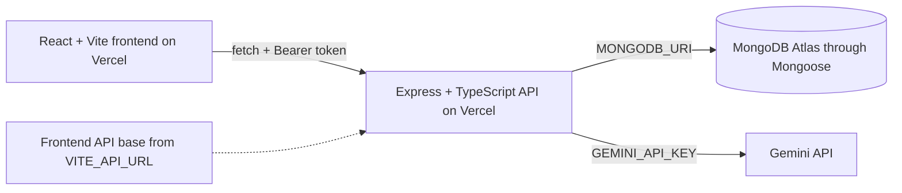

# Campus Lost & Found Tracker API

This repository contains the Express and TypeScript API for the Campus Lost & Found Tracker. It persists users, item reports, and claims in MongoDB through Mongoose, protects signed-in operations with JWT authentication, validates AI review requests with Zod, and provides a rate-limited Gemini review endpoint for lost and found item reports.

## Features

- MongoDB and Mongoose persistence for users, items, and claims.
- JWT authentication for protected operations.
- Item browsing and owner-managed item routes.
- Authenticated claim routes.
- Zod validation for AI item-report descriptions.
- Protected Gemini-powered report review with a limit of five requests per user per minute.
- Health endpoint that reports API and database readiness.

## API routes

| Method | Path | Access | Purpose |
| --- | --- | --- | --- |
| GET | /api/health | Public | API and database readiness |
| POST | /api/auth/register | Public | Register an account |
| POST | /api/auth/login | Public | Sign in and receive a JWT |
| GET | /api/items | Public | Browse item reports |
| GET | /api/items/:id | Public | Read an item report |
| POST | /api/items | JWT | Create an item report |
| PATCH | /api/items/:id | JWT | Update an owned item report |
| DELETE | /api/items/:id | JWT | Delete an owned item report |
| GET | /api/claims | JWT | List the signed-in user's claims |
| POST | /api/claims | JWT | Submit an item claim |
| POST | /api/ai | JWT and rate limited | Review a lost or found item report |

Protected routes expect an Authorization header in the form Bearer followed by a valid JWT.

## Architecture

## Local setup

Use Node 24 and npm.

1. Copy .env.example to .env.
2. Set MONGODB_URI, JWT_SECRET, CORS_ORIGIN, GEMINI_API_KEY, and PORT in the local environment. Keep real values in the ignored .env file or your deployment secret store.
3. For local frontend development, use http://localhost:5173 as the CORS_ORIGIN value. The backend listens on port 4000 by default when PORT is unset.
4. Install dependencies with npm ci.
5. Start the API with npm run dev.

## Development commands

- npm run dev — start the TypeScript API in watch mode.
- npm run typecheck — run the TypeScript checker without emitting files.
- npm test — run the Vitest and Supertest authentication tests.
- npm run build — compile the API into dist.
- npm start — run the compiled server.

## Environment variables

The .env.example file lists variable names only and contains no configured values.

| Name | Purpose |
| --- | --- |
| MONGODB_URI | MongoDB Atlas connection string |
| JWT_SECRET | Secret used to sign and verify JWTs |
| CORS_ORIGIN | Allowed browser origin; use http://localhost:5173 for local frontend development |
| GEMINI_API_KEY | Credential for the Gemini API |
| PORT | Optional server port; defaults to 4000 |

For production, CORS_ORIGIN must be the exact frontend Vercel origin without a trailing slash.

## Live deployments and related repository

- Backend: [itelect4-backend-woad.vercel.app](https://itelect4-backend-woad.vercel.app)
- Health endpoint: [api/health](https://itelect4-backend-woad.vercel.app/api/health)
- Frontend: [itelect4-project-pi.vercel.app](https://itelect4-project-pi.vercel.app)
- Frontend repository: [itelect4-project on GitHub](https://github.com/JaneAllysonParay/itelect4-project)

## AI-use disclosure

AI tools were used as development assistants for selected code review, testing/CI guidance, and documentation tasks. The final implementation remains subject to the student's own review, testing, and explanation.
